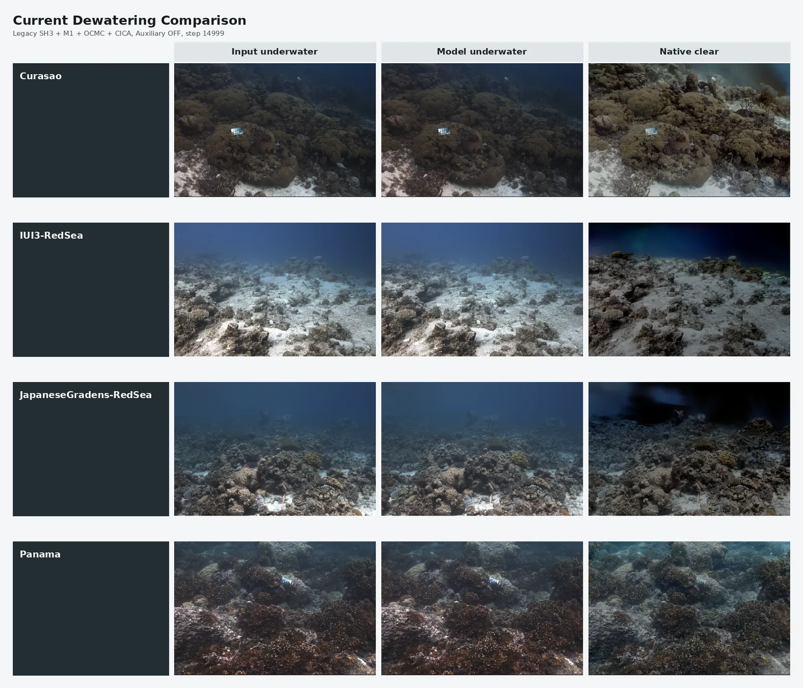
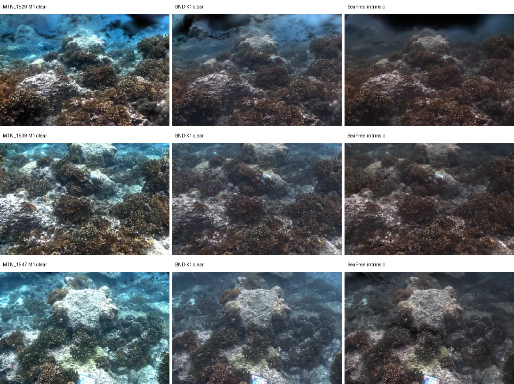
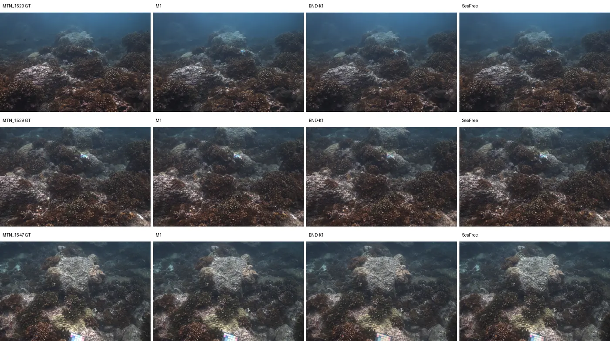

# WaterSplatting Project State and BND Trade-off

Date: 2026-09-07
Branch: `research/m1-bounded-intrinsic`
Repository: `MokiSumiwo/water-splatting-refactor-ycy`

## Executive Summary

This project extends the original WaterSplatting model for underwater 3D Gaussian Splatting. The current research line retains two mechanism-level contributions:

1. **M1 + OCMC**: camera-context medium modeling followed by an observability-controlled projection of the camera-conditioned medium residual.
2. **CICA**: cross-view intrinsic chromaticity anchoring of Gaussian DC appearance.

The current metric-best formal configuration in the corrected RGB evaluation is:

```text
M1 + OCMC + CICA
Auxiliary appearance regularization: OFF
BND: OFF (legacy SH3 intrinsic parameterization)
RAOC: OFF
step: 14999
```

The main unresolved design decision is **BND** (bounded SH3 intrinsic appearance):

- With BND, the intrinsic/clear representation is range-controlled and the high-radiance decomposition route is removed. The clear/dewatered images generally look more stable and less dominated by bright blue/cyan residuals.
- Without BND, underwater RGB reconstruction retains more appearance capacity and gives stronger or more consistent underwater metrics, but the intrinsic/clear output can contain high-value or water-like residuals.

The evidence does not justify declaring either side universally correct. The most accurate current conclusion is:

> BND improves decomposition legality and stability, but changes the capacity allocation between Gaussian appearance, medium, and geometry. Under the current fixed training protocol, that can reduce underwater RGB fitting quality in scene-dependent ways.

There is no paired real clear-image ground truth in the four scenes. Therefore, clear/dewatered quality claims are qualitative or distributional observations, not supervised quantitative conclusions.

## Repository and Reproducibility State

### Code State

- Current branch: `research/m1-bounded-intrinsic`
- Current HEAD before this documentation commit: `f32a7a5` (`Complete four-scene MDRR and CICA experiment`)
- Remote: `git@github.com:MokiSumiwo/water-splatting-refactor-ycy.git`
- No training or evaluation process was running when this report was prepared.
- Local generated data are intentionally excluded from GitHub by `.gitignore`:
  `outputs/`, `renders/`, `undistorted_data/`, `logs/`, checkpoints, and generated PNG/JPEG files.

The code changes and research utilities are kept in the repository, but the large numerical artifacts remain local. The local `outputs/` directory is approximately 116 GB and `renders/` is approximately 523 MB, so committing those directories would make the repository impractical to clone.

### Metric Protocol

The current corrected RGB tables use the repository-local `metrics.py`, not `ns-eval`:

- exact filename pairing between prediction and ground truth;
- RGB tensors in `[0, 1]`;
- no resize, crop, or color conversion during evaluation;
- project PSNR and SSIM implementations;
- local `lpipsPyTorch` LPIPS-VGG v0.1 implementation;
- arithmetic mean over valid views, then scene-level arithmetic mean where reported.

The original WaterSplatting baseline was **not retrained** for the corrected table. Its values are archival final metrics from the existing baseline run. The two treatment configurations were rendered/evaluated from one final checkpoint per scene.

## Original WaterSplatting Model

The original model represents the scene with explicit 3D Gaussians and represents the underwater medium with a direction-conditioned per-pixel field. For a camera ray, the medium predicts nine raw values:

```text
raw = [medium_rgb_logits(3), backscatter_density_raw(3), attenuation_density_raw(3)]
```

The first three channels are passed through a sigmoid to obtain medium color. The density channels are passed through softplus. The Gaussian colors and the medium are then combined by the existing underwater rasterizer.

The rasterizer returns, among other quantities:

```text
rgb_object       direct Gaussian/object contribution
rgb_medium       finite medium contribution and tail contribution
rgb               rgb_object + rgb_medium
rgb_clear_raw    raw clear/intrinsic Gaussian accumulation
```

The current implementation preserves this forward compositing structure. OCMC and CICA modify selected representation or gradient paths; they do not replace the underwater compositor with a different physical renderer.

## M1: Camera-Context Medium Representation

M1 is an important prerequisite and must not be confused with OCMC. The original baseline does **not** contain M1.

In the formal current setup, the medium input has 22 channels:

```text
16-D direction encoding
+ 3-D image context: x, y, sqrt(x^2 + y^2)
+ 3-D scene-normalized camera-center context
= 22-D medium input
```

The camera center is normalized with the scene bounding-box center and scale. The camera context is a learned input to the medium MLP, not a separate physical medium parameter. This extra context improves the model's ability to explain view-dependent underwater appearance, but also creates a possible compensation route: the medium can use camera-specific variation that is weakly constrained by the available observations.

The current naming should therefore be read as:

```text
M1 + OCMC + CICA
```

where M1 supplies the camera-context representation, OCMC controls its weakly observable residual, and CICA regularizes intrinsic Gaussian chromaticity.

## Innovation 1: OCMC

### Name and Purpose

OCMC means **Observability-Controlled Medium Context**. It targets the following failure mode:

> A camera-conditioned medium field can produce raw residual directions that have little observable effect in the training views. Those directions can still absorb appearance/medium compensation and become unstable when the camera changes.

OCMC is intended to reduce this weakly observable camera-conditioned residual while preserving useful camera context.

### Forward Mechanism

For a camera and pixel, the medium MLP is evaluated twice:

```text
z_full = f(direction, image_xy_context, real_camera_context)
z_base = f(direction, image_xy_context, zero_camera_context)
Delta_z_cam = z_full - z_base
```

The difference isolates the part of the raw nine-dimensional medium output that depends on the camera context. A detached calibration stage estimates a structured RGB Jacobian over training views. SVD/eigendecomposition produces a basis and a spectrum in the 9-D raw medium-output space. The spectrum is converted into a fixed observability gate and a detached projector `P_obs`.

With per-channel standardization scale `s`, the projected residual is:

```text
Delta_z_std  = Delta_z_cam / s
Delta_z_proj = s * (Delta_z_std @ P_obs^T)
```

The effective raw medium output is:

```text
z_effective = z_base
              + (1 - strength) * Delta_z_cam
              + strength * Delta_z_proj
```

The formal experiment uses `strength = 1.0`, so the effective camera residual is the projected residual. The projector is refreshed at fixed training milestones, typically steps `0`, `5000`, and `10000`, using detached calibration state.

### What OCMC Changes and Does Not Change

OCMC changes only the camera-conditioned residual in the raw medium output before the unchanged sigmoid/softplus activations. It does not directly change:

- Gaussian positions, scales, rotations, or opacity;
- Gaussian SH coefficients;
- the forward underwater rasterizer or alpha compositing;
- the medium activation functions;
- held-out ground truth or a learned true-medium label.

The projector, SVD/Jacobian statistics, and calibration scales are detached. OCMC is mutually exclusive with RAOC in the current implementation.

### OCMC Causal Evidence

The formal IUI3 causal experiment found:

```text
held-out PSNR(C1 - C0) = +0.130078 dB
held-out SSIM(C1 - C0) = -0.000974
held-out LPIPS(C1 - C0) = -0.000144
```

The mechanism audit confirmed decreased energy in the weak component and decreased weak projection relative to a random `1/9` reference. However, the correct classification remains:

```text
OCMC_PARTIALLY_ACTIONABLE
```

The experiment did not prove recovery of true water properties, true colors, or true geometry. It supports a representation-capacity allocation interpretation: OCMC suppresses part of a low-observability camera residual that can otherwise be used as a compensation channel.

## Innovation 2: CICA

### Name and Hypothesis

CICA means **Cross-view Intrinsic Chromaticity Anchoring**. It addresses a different source of ambiguity:

> Intrinsic Gaussian appearance, especially for distant or weakly constrained Gaussians, can absorb a color bias that is consistent across views. Once stored in the Gaussian DC appearance, the bias survives the removal of the medium and appears as residual water color in the clear output.

CICA does not assume that every blue pixel is wrong and does not impose a hand-written blue-removal prior. It uses cross-view consistency and the renderer's local sensitivity instead.

### Controller Construction

CICA uses training cameras only:

1. Select at most six deterministic training cameras from the fixed camera bank.
2. Render each camera with the real Gaussian visibility, attenuation, alpha compositing, and medium state.
3. Compute a local first-order DC appearance response for each visible Gaussian. The response includes the renderer visibility/attenuation terms and the correct color Jacobian for the active intrinsic parameterization.
4. Convert the DC RGB estimate to log-chroma:

   ```text
   u = log((R + eps) / (G + eps))
   v = log((B + eps) / (G + eps))
   ```

5. Aggregate the valid view observations with information weighting and a robust weighted median. A Gaussian needs support in at least three valid training views.
6. Detach the resulting canonical target before the loss is evaluated.

The robust target is therefore based on multi-view evidence, not held-out PSNR, held-out LPIPS, a global blue prior, or a manually selected clear-image color.

### Training Loss and Gradient Boundary

The CICA loss is a weighted Huber penalty in log-chroma space:

```text
L_CICA = weighted_mean(Huber(current_log_chroma - target_log_chroma))
```

The loss produces gradients only for `features_dc`. It does not directly update:

- medium MLP parameters;
- Gaussian geometry or opacity;
- non-DC SH coefficients (`features_rest`);
- OCMC projector state.

At first activation, the CICA gradient is calibrated once to 10% of the photometric DC gradient norm. There is no lambda sweep in the formal result. The target and all information weights are detached; after topology changes, the controller is rebuilt for the new Gaussian population.

### CICA Causal Evidence

In the corrected Auxiliary-OFF legacy-SH3 experiment, the direct comparison is CICA versus the matched M1 + OCMC state:

```text
mean dPSNR = +0.115898 dB
mean dSSIM = +0.000303
mean dLPIPS = -0.000281
mean dMSE = -0.000109199
```

CICA improved PSNR in all four scene endpoints in this fixed protocol. The gain is modest and does not, by itself, prove that intrinsic appearance has been physically purified. The clear-image observation is a mild distributional shift, not a decisive visual improvement with a known ground truth.

## Current Corrected Underwater RGB Results

The following table is the current primary metric table. The original baseline row is archival and was not retrained. Metrics are computed at step `14999` with the local `metrics.py` protocol.

Higher is better for PSNR/SSIM; lower is better for LPIPS/MSE.

| Configuration | Scene | PSNR | SSIM | LPIPS | MSE |
|---|---|---:|---:|---:|---:|
| Original WaterSplatting baseline | Curasao | 31.669132 | 0.954442 | 0.120678 | 0.001212885 |
| Original WaterSplatting baseline | IUI3-RedSea | 30.112491 | 0.912285 | 0.179530 | 0.001625306 |
| Original WaterSplatting baseline | JapaneseGradens-RedSea | 25.051662 | 0.900073 | 0.118177 | 0.004621249 |
| Original WaterSplatting baseline | Panama | 31.840663 | 0.945787 | 0.076261 | 0.000667964 |
| **Original baseline mean** | **4 scenes** | **29.668487** | **0.928147** | **0.123661** | **0.002031851** |
| M1 + OCMC | Curasao | 31.976023 | 0.955038 | 0.124254 | 0.000984629 |
| M1 + OCMC | IUI3-RedSea | 31.055441 | 0.911761 | 0.194773 | 0.001405031 |
| M1 + OCMC | JapaneseGradens-RedSea | 24.524046 | 0.893864 | 0.134439 | 0.005485460 |
| M1 + OCMC | Panama | 32.107956 | 0.947736 | 0.099010 | 0.000624659 |
| **M1 + OCMC mean** | **4 scenes** | **29.915866** | **0.927100** | **0.138119** | **0.002124945** |
| M1 + OCMC + CICA, Auxiliary OFF | Curasao | 32.209305 | 0.955404 | 0.123685 | 0.000862807 |
| M1 + OCMC + CICA, Auxiliary OFF | IUI3-RedSea | 31.107620 | 0.911909 | 0.194955 | 0.001414615 |
| M1 + OCMC + CICA, Auxiliary OFF | JapaneseGradens-RedSea | 24.636551 | 0.894535 | 0.133297 | 0.005172848 |
| M1 + OCMC + CICA, Auxiliary OFF | Panama | 32.173580 | 0.947764 | 0.099413 | 0.000612713 |
| **M1 + OCMC + CICA mean** | **4 scenes** | **30.031764** | **0.927403** | **0.137838** | **0.002015746** |

### Matched Module Deltas

The direct module deltas, which are the correct values for attribution, are:

| Comparison | Mean dPSNR | Mean dSSIM | Mean dLPIPS | Mean dMSE |
|---|---:|---:|---:|---:|
| M1 + OCMC minus original baseline | +0.247379 | -0.001047 | +0.014458 | +0.000093094 |
| CICA minus M1 + OCMC | +0.115898 | +0.000303 | -0.000281 | -0.000109199 |

These are not additive claims about independent physical effects. The OCMC row compares against the original baseline endpoint; the CICA row compares against its matched M1 + OCMC endpoint. For full per-scene deltas, see `research_notes/IMPROVEMENT_METRIC_SUMMARY_2026-09-05.md` and `outputs/ablation_rgb_metrics_20260907/final_corrected/deltas.csv`.

## BND: Bounded SH3 Intrinsic Appearance

### Definition

The legacy WaterSplatting SH3 color uses the active SH evaluation plus a fixed offset:

```text
c_legacy(v) = clamp(SH_3(features_dc, features_rest, viewdir) + 0.5, min=0)
```

The lower clamp is applied, but there is no corresponding upper bound. The raw clear Gaussian accumulation can consequently contain values above one (`J > 1`).

BND interprets the full active SH3 output as an RGB logit:

```text
s(v)     = SH_3(features_dc, features_rest, viewdir)
c_BND(v) = sigmoid(s(v))
```

The color-equivalent initialization is:

```text
features_dc = logit(seed_rgb, eps=1e-7) / C0
features_rest = 0
C0 = 0.28209479177387814
```

The formal BND candidate kept SH degree 3, the optimizer, the medium, the rasterizer, densification, pruning, opacity behavior, and the RGB loss unchanged. Only the intrinsic color parameterization was changed.

### Why BND Helps Clear Rendering

BND constrains every per-Gaussian channel to the open interval `(0, 1)`. In the current experiments this has several consequences:

- removes the legacy high-radiance/high-`J` escape route;
- drives `P(J > 1)` to zero in the tested final states;
- reduces the high-`J` tail and direct optical-depth proxy `tau_D`;
- reduces extreme bright blue/cyan intrinsic residuals;
- produces a more range-controlled clear/intrinsic representation.

The important interpretation is not that BND directly estimates the true clear color. It reduces one way in which the original model can explain underwater observations by putting excessive color into the Gaussian appearance. The optimizer then reallocates the explanation across appearance, medium, and geometry.

### Why BND Can Hurt Underwater RGB Metrics

BND also changes the optimization geometry. The full SH residual is passed through a sigmoid, whose derivative is:

```text
dc/ds = c * (1 - c)
```

When a channel approaches zero or one, its available gradient and headroom decrease. Thus BND removes both invalid radiance and some useful fitting capacity. A scene whose underwater RGB reconstruction relied on a high-valued SH residual can lose PSNR or SSIM even though its intrinsic output looks more controlled.

This is the current working explanation for the observed trade-off:

```text
legacy SH3: more underwater appearance capacity, more decomposition ambiguity
BND SH3:    less decomposition ambiguity, less underwater appearance capacity
```

BND is a representation/constraint option, not OCMC and not CICA. It should not be described as one of the two core innovations.

## BND Cross-Scene Evidence

The following is the matched four-scene BND validation protocol, separate from the corrected Auxiliary-OFF CICA table above. It compares the corresponding M1 and BND endpoints under the BND validation setup.

| Scene | M1 PSNR | BND PSNR | dPSNR | dSSIM | dLPIPS | M1 tau p90 | BND tau p90 | M1 J p99 | BND J p99 |
|---|---:|---:|---:|---:|---:|---:|---:|---:|---:|
| Curasao | 32.165164 | 32.188016 | +0.022852 | +0.002724 | +0.001067 | 2.504676 | 1.533122 | 2.350653 | 0.900398 |
| IUI3-RedSea | 30.874542 | 30.963132 | +0.088590 | -0.000499 | +0.002465 | 1.497287 | 0.928444 | 1.137097 | 0.904771 |
| JapaneseGradens-RedSea | 24.756484 | 24.698505 | -0.057979 | -0.003200 | -0.003073 | 1.947181 | 0.712033 | 1.348906 | 0.966225 |
| Panama | 32.308910 | 31.498353 | **-0.810558** | -0.000704 | +0.001542 | 1.769849 | 0.999069 | 1.311801 | 0.838911 |
| **Mean dPSNR** |  |  | **-0.189274** | **-0.000420** | **+0.000500** |  |  |  |  |

The key pattern is consistent across scenes in the decomposition proxies:

```text
P(J > 1): zero for BND in all four scenes
tau_D p90: lower for BND in all four scenes
J p99: lower for BND in all four scenes
```

The RGB consequence is scene-dependent. Curasao and IUI3 passed the registered RGB safety gate; JapaneseGradens failed the SSIM gate; Panama failed the PSNR gate by `0.810558 dB`. Panama is the clearest counterexample to deploying the current fixed BND parameterization without further capacity recovery.

The BND result therefore supports the following narrower statement:

> Unbounded intrinsic appearance is a major object-medium compensation degree of freedom in the current WaterSplatting representation, but simply removing that freedom does not preserve underwater RGB quality across all scenes.

## Visual Evidence

### Current Recommended Configuration: Four-Scene Dewatering View

This contact sheet is generated from the current `M1 + OCMC + CICA`, Auxiliary-OFF, BND-OFF checkpoint renders. It contains input underwater, model underwater, and native clear outputs for the four scenes. It is qualitative only because no paired real clear ground truth exists.



Source image: `renders/current_dewatering_cica_no_auxiliary_20260905/current_dewatering_comparison.png`
Source manifest: `renders/current_dewatering_cica_no_auxiliary_20260905/comparison_manifest.json`

### BND Intrinsic/clear Trade-off: Panama

This diagnostic contact sheet compares M1 clear, BND-K1 clear, and a SeaFree reference render. BND-K1 is the bounded SH3 representation. The panel should be read as a representation-range diagnostic, not as proof that the BND image is the true clear scene.



Source image: `renders/seafree_legal_panama_20260810/contact_sheet_intrinsic_m1_k1_seafree.png`
Source index: `renders/seafree_legal_panama_20260810/VISUAL_COMPARE_INDEX.md`

### BND Underwater Reconstruction Trade-off: Panama

This diagnostic contact sheet compares the underwater target and the M1, BND-K1, and SeaFree reconstructions. It illustrates why clear-image visual stability and underwater RGB reconstruction must be evaluated separately.



Source image: `renders/seafree_legal_panama_20260810/contact_sheet_underwater_m1_k1_seafree.png`

## Status of Other Directions

### Auxiliary Appearance Regularization

The earlier SH-opacity tangent regularizer can produce a small RGB effect, but the mechanism audit did not support it as a distinct identifiability innovation. It is therefore classified as:

```text
generic auxiliary appearance regularization
```

It may be retained as a baseline training regularizer in protocols that explicitly include it, but it must not be presented as the second core innovation. The current primary CICA table above intentionally reports Auxiliary OFF.

### RAOC

RAOC is a later ray-adaptive observability extension. The current research line does not use it in the recommended configuration. OCMC and RAOC are mutually exclusive in the current implementation, and RAOC is not part of the two-innovation claim documented here.

### MDRR

MDRR (multi-view degradation responsibility routing) was tested in the formal four-scene matrix. It changed topology substantially and caused large RGB degradation. The formal classification was:

```text
MDRR: DROP
MDRR + CICA interaction: INTERFERING
```

The combined MDRR+CICA arm should not be used as evidence for the current method.

### Other Earlier Ideas

Several earlier directions, including direct optical-depth scaling, background/medium attribution variants, infinite-water ownership variants, and other diagnostic regularizers, were explored in separate notes. They are not part of the current two-innovation claim. The relevant notes remain in `research_notes/` for auditability, but their generated outputs should not be treated as current positive evidence.

## Current Checkpoints and Render Paths

### Recommended M1 + OCMC + CICA, Auxiliary OFF, BND OFF

The four final checkpoints are:

```text
outputs/legacy_ocmc_cica_no_auxiliary_20260905/Curasao/checkpoints/step-000014999.ckpt
outputs/legacy_ocmc_cica_no_auxiliary_20260905/IUI3-RedSea/checkpoints/step-000014999.ckpt
outputs/legacy_ocmc_cica_no_auxiliary_20260905/JapaneseGradens-RedSea/checkpoints/step-000014999.ckpt
outputs/legacy_ocmc_cica_no_auxiliary_20260905/Panama/checkpoints/step-000014999.ckpt
```

Their native render directories are:

```text
renders/legacy_ocmc_cica_no_auxiliary_20260905/<scene>/step_14999/<view>/A2/
```

Each selected view directory contains:

```text
underwater.png
clear.png
clear_raw_display_clamp01.png
```

The compact four-scene visual summary is:

```text
renders/current_dewatering_cica_no_auxiliary_20260905/current_dewatering_comparison.png
renders/current_dewatering_cica_no_auxiliary_20260905/current_dewatering_raw_clamp01_comparison.png
```

### M1 + OCMC, Auxiliary OFF, BND OFF

The corrected analysis-only render source is:

```text
renders/ablation_m1_ocmc_recovered_20260907_v2/<scene>/<view>.png
```

The corresponding source checkpoints are:

```text
outputs/legacy_no_bounded_three_improvements_20260905/<scene>/checkpoints/C0/step-000014999.ckpt
```

### BND Validation Artifacts

The BND cross-scene metric summaries are in:

```text
outputs/ocmc_bounded_baseline_four_scene_20260905_v3/<scene>/final_metrics.csv
outputs/ocmc_bounded_baseline_four_scene_20260905_v3/<scene>/final_summary.json
```

The full BND visual/diagnostic archives, where available locally, are described by:

```text
research_notes/BOUNDED_SH3_CROSS_SCENE_VALIDATION_2026-08-08.md
research_notes/BND_RGB_TRADEOFF_DIAGNOSIS_2026-08-09.md
research_notes/BND_HEADROOM_SH3_APPEARANCE_2026-08-10.md
```

## Recommended Next Research Question

The next discussion should not ask whether BND is simply "correct" or "incorrect." The precise question is:

> Can BND preserve its bounded, legal intrinsic representation while recovering the underwater appearance capacity that the legacy SH3 solution used, without reopening the high-`J` object-medium compensation route?

Candidate investigations should remain causal and capacity-aware:

- measure which SH channels and scenes lose fitting headroom under BND;
- separate DC base capacity from bounded view-dependent residual capacity;
- test any new bounded parameterization against both underwater RGB and clear-range diagnostics;
- keep OCMC and CICA fixed while testing BND variants;
- report clear rendering as qualitative unless paired clear ground truth becomes available;
- use one checkpoint per scene for joint PSNR/SSIM/LPIPS selection rather than selecting each metric from different checkpoints.

## Final Current Position

The defensible current project position is:

```text
Core innovation 1: M1 + OCMC
Core innovation 2: CICA
Current metric-best configuration: M1 + OCMC + CICA, Auxiliary OFF, BND OFF
BND: promising decomposition constraint, but unresolved RGB-capacity trade-off
Auxiliary: baseline-only regularizer, not a core innovation
RAOC: not part of the current claim
MDRR: dropped after formal four-scene degradation
```

The code and this state report are being pushed without generated checkpoints, `outputs/`, or `renders/` archives. The latter remain available on the current machine at the paths listed above.
